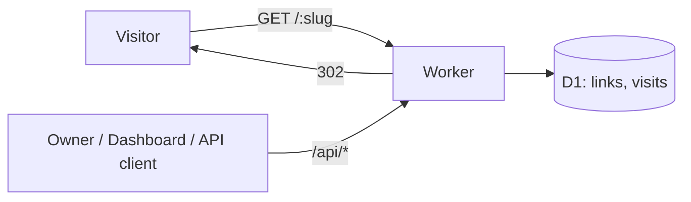

# OpenBitly — Architecture

Status: proposed
Date: 2026-07-19
Depends on: [0_one_pager.md](0_one_pager.md)

## Decision

OpenBitly runs entirely on **Cloudflare**, as a single Worker:

| Concern | Choice |
|---|---|
| Compute / routing | Cloudflare Workers + [Hono](https://hono.dev) |
| Database (links + visit counts) | Cloudflare D1 (SQLite) |
| Dashboard | Static assets served by the same Worker (v1: single vanilla-JS page; Vite + React if it outgrows that) |
| QR codes | Generated in-Worker with a pure-JS library, SVG output |
| Deploy | Wrangler (`wrangler deploy`), config in `wrangler.toml` |

Why Cloudflare over Vercel: it is the only option that satisfies the single-provider
constraint (Vercel has no first-party database), Workers' ~0ms cold starts fit the
latency-sensitive redirect path, and the free tier permits commercial use. See the
one-pager's infrastructure constraint for the rationale.

Why one Worker instead of several: a URL shortener is small enough that splitting
redirect/API/dashboard into separate services only adds deploy and routing overhead.
One Worker, one D1 binding, one deploy.

## System overview



All traffic — redirects, the REST API, the dashboard, QR images — hits the same
Worker on the user's custom domain.

## Routing

Route precedence inside the Worker (Hono):

| Route | Purpose |
|---|---|
| `GET /` and `/dashboard/*` | Dashboard static assets |
| `GET /api/*`, `POST/PATCH/DELETE /api/*` | REST API (token-authenticated) |
| `GET /:slug` | Redirect (the hot path) |
| `GET /:slug/qr` | QR code for the short link (SVG) |

Reserved slugs (`api`, `dashboard`, `qr`, …) are rejected at link-creation time so
they can never shadow application routes.

## Data model (D1)

```sql
CREATE TABLE links (
    slug        TEXT PRIMARY KEY,           -- e.g. "a1B2c3" or custom
    destination TEXT NOT NULL,              -- current target URL
    visit_count INTEGER NOT NULL DEFAULT 0, -- denormalized total, cheap to read
    created_at  TEXT NOT NULL,              -- ISO 8601
    updated_at  TEXT NOT NULL
);

CREATE TABLE visits (
    id       INTEGER PRIMARY KEY AUTOINCREMENT,
    slug     TEXT NOT NULL REFERENCES links(slug) ON DELETE CASCADE,
    ts       TEXT NOT NULL,                 -- ISO 8601
    referrer TEXT,
    country  TEXT,                          -- from request.cf.country
    ua       TEXT
);

CREATE INDEX idx_visits_slug_ts ON visits(slug, ts);
```

- `links.visit_count` answers the common "how many visits" question with a single
  primary-key read; the `visits` table keeps per-event detail for breakdowns.
- Destination edits update `links.destination` in place — the slug (and therefore
  the QR code) never changes.

## Request flows

### Redirect — `GET /:slug` (hot path)

1. `SELECT destination FROM links WHERE slug = ?` (primary-key lookup).
2. Miss → 404 page. Hit → respond **302** immediately.
3. After responding, record the visit via `ctx.waitUntil()`:
   `UPDATE links SET visit_count = visit_count + 1` and `INSERT INTO visits (...)`.

Two rules keep this path fast and correct:

- **302, never 301.** Browsers cache 301s indefinitely; a cached 301 would break
  the editable-destination feature for that visitor forever.
- **Counting never blocks the redirect.** The visitor gets the 302 first; the two
  writes happen in `waitUntil` after the response is sent. If a write occasionally
  fails, we lose one count — acceptable for v1 analytics.

### Create — `POST /api/links`

Body: `{ destination, slug? }`. Validates the destination is `http(s)`, generates a
random base62 slug (retry on collision) unless a custom one is given, rejects
reserved and duplicate slugs (409). Returns the link record plus its short URL and
QR URL.

### Edit destination — `PATCH /api/links/:slug`

Body: `{ destination }`. Updates in place; all existing shares and printed QR codes
now point at the new destination. This is the feature 301-caching would break.

### QR — `GET /:slug/qr`

Generates an SVG QR of the short URL in-Worker (no canvas/native deps — SVG output
from a pure-JS encoder). Served with a long `Cache-Control` since the short URL for
a slug never changes. `?format=png` can come later if needed.

### Stats — `GET /api/links/:slug/stats`

`visit_count` from `links`, plus grouped queries over `visits` (by day, referrer,
country) with a time-range parameter.

## Authentication

v1 is single-owner:

- One API token, stored as a Worker secret (`wrangler secret put API_TOKEN`),
  sent as `Authorization: Bearer <token>`.
- All `/api/*` routes require it. Redirects and QR routes are public.
- The dashboard is a static app that asks for the token once and keeps it in
  memory/localStorage — no session backend needed.

Multi-user auth is explicitly deferred (see one-pager "Later").

## Free-tier fit

| Resource | Free quota (daily) | v1 usage |
|---|---|---|
| Worker requests | 100k | 1 per redirect / API call / asset |
| D1 reads | 5M rows | 1 per redirect |
| D1 writes | 100k rows | 2 per redirect (count + visit row) |

The binding constraint is **D1 writes: ~50k redirects/day** on the free tier.
Well beyond personal use; if a link goes viral, the paid tier is $5/mo, or see
scaling below.

## Deliberately deferred

- **KV read-through cache for redirects** — D1 PK lookups are fast enough for v1;
  KV adds an invalidation problem on destination edits. Add only if latency data
  says so.
- **Workers Analytics Engine for visits** — removes the D1-write bottleneck at
  scale (unlimited-ish event writes), but its data is sampled and TTL'd. The
  `visits` table is simpler and sufficient at v1 traffic.
- **PNG QR, link expiration, teams** — per the one-pager.

## Repository layout

```
/
├── src/
│   ├── index.ts        # Worker entry, Hono app, route precedence
│   ├── redirect.ts     # hot path
│   ├── api/            # links CRUD, stats
│   └── qr.ts
├── public/             # dashboard static assets (v1: vanilla JS single page)
├── migrations/         # D1 SQL migrations (wrangler d1 migrations)
├── wrangler.toml
└── docs/
```
